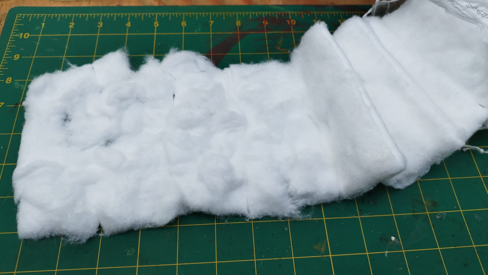
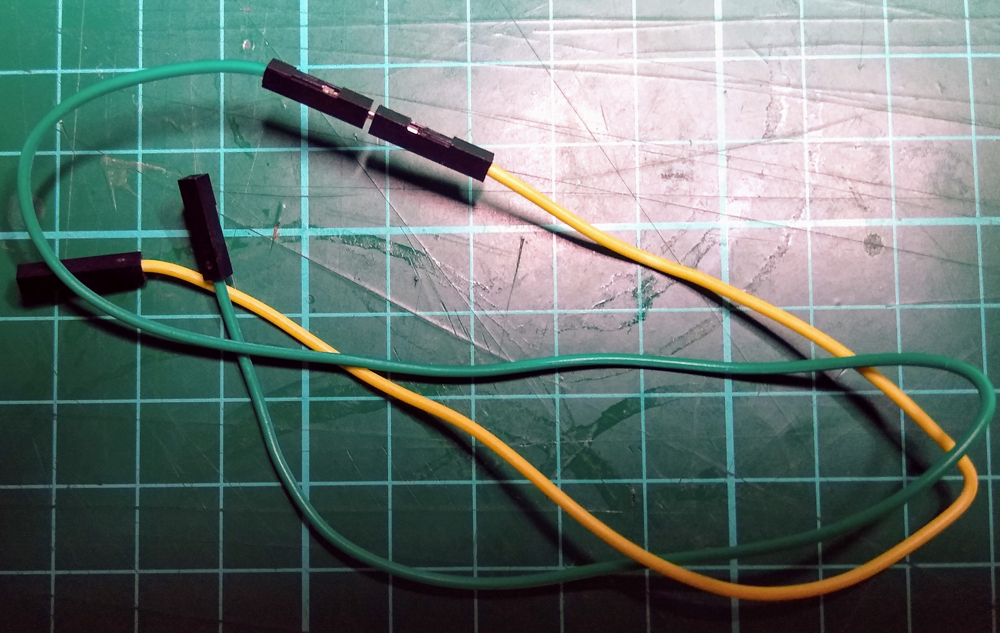
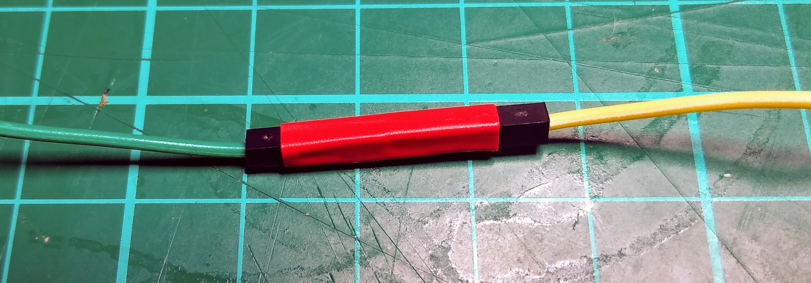
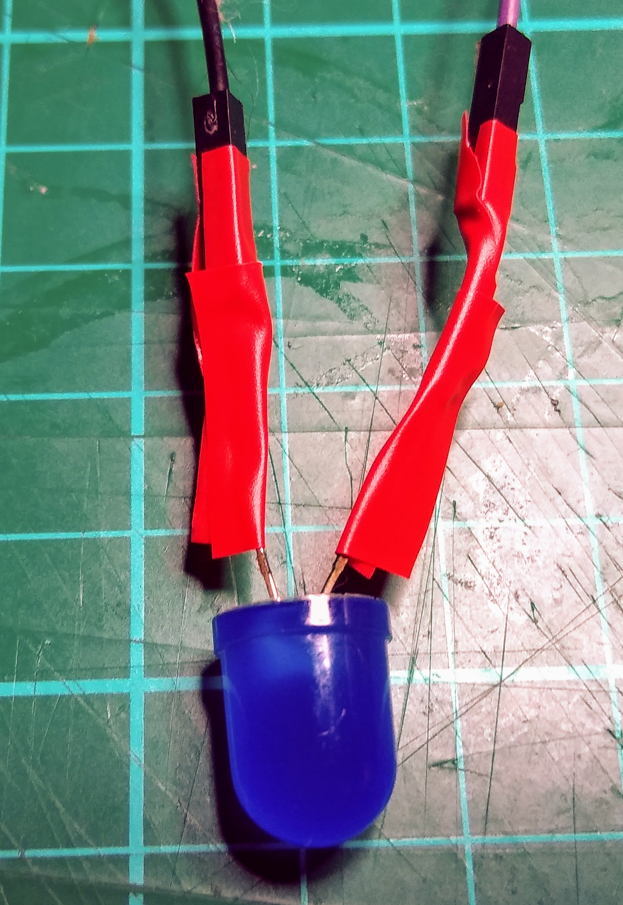

## Build your model

Now that you have a plan, it's time to build your thunder cloud. Below are a few tips that might help you to produce the model you want.


--- task ---

Shut down your Raspberry Pi and disconnect its power before wiring your LEDs. Each LED needs its **own 330Ω resistor in series** to limit the current.

Use three socket-socket jumper wires for each LED:

1. Connect a GPIO pin to one leg of a 330Ω resistor.
1. Connect the other resistor leg to the LED's **long leg (anode)**.
1. Connect the LED's **short leg (cathode)** to a **GND** pin.

Either way round is fine for the resistor. Keep the two LED legs apart and insulate each exposed connection with tape.

The example uses **GPIO21 (physical pin 40)** with **GND (physical pin 39)**, and **GPIO26 (physical pin 37)** with **GND (physical pin 34)**. Use the GPIO numbers 21 and 26 in Scratch.


--- /task ---

--- task ---

Take your cotton wool roll and lay it out flat on the table. Pinch or stretch it gently to make it look fluffy.


--- /task ---

--- task ---

With the power still disconnected, place the LEDs on top of the cotton wool and wrap them up, making sure the cables all come out of one end. Keep the resistors and the Raspberry Pi outside the cotton wool, and keep every exposed connection insulated.

You should place them slightly apart, and could even wrap up one or two, then add more in extra layers to spread them around inside the cloud.

--- /task ---

Shape the cotton wool around the LEDs to make your cloud. Check that each LED still has its own resistor in series before reconnecting the Raspberry Pi power.

--- collapse ---
---
title: Using a craft or utility knife
---

Craft and utility knives are very useful when making models, but you must be very careful when using them, as they are extremely sharp and can easily cause an injury. If you are using a craft or utility knife, make sure you have a responsible adult with you, or ask them to do the cutting for you if you prefer. It's also a good idea to use a cutting mat to protect the surface you are working on. If you don't have a cutting board, a kitchen chopping board is a great alternative.


--- /collapse ---

--- collapse ---
---
title: Joining together jumper wires
---

You might need extra-long wires to attach your LED to your Raspberry Pi pins. You can do this by 'daisy chaining' wires together. For instance, to make an extra-long Socket-Socket wire, you can attach an Socket-Pin wire to a Socket-Socket wire.



The problem with this method is that often the wires will become detached from each other. You can use a small piece of tape to secure the connection.



--- /collapse ---

--- collapse ---
---
title: Short circuits
---

As the legs of the LEDs are often exposed, it is easy for to create a **short circuit** if the exposed legs touch each other. This will stop your LED from working. A little bit of tape wrapped around each LED leg will prevent this.



This will also help to keep the LED attached to its jumper wires.

--- /collapse ---

--- collapse ---
---
title: Multiple LEDs
---

You might have only used a single LED in your projects before, but you can use lots of LEDs if you want to. Each LED needs its own 330Ω resistor between its long leg and a GPIO pin, with its short leg connected to a GND pin. Do not connect an LED directly between GPIO and GND or share one resistor between LEDs. You can see the location of all the numbered pins and ground pins in the diagram below.


To control the LEDs, you just change the pin number in your Scratch program so it corresponds to the pin the LED is attached to.

```blocks3
turn LED (21 v) [on v] ::extension
turn LED (26 v) [off v] ::extension
```

--- /collapse ---